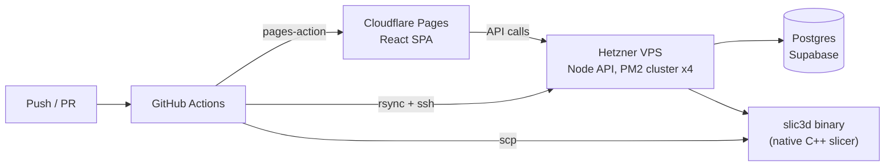
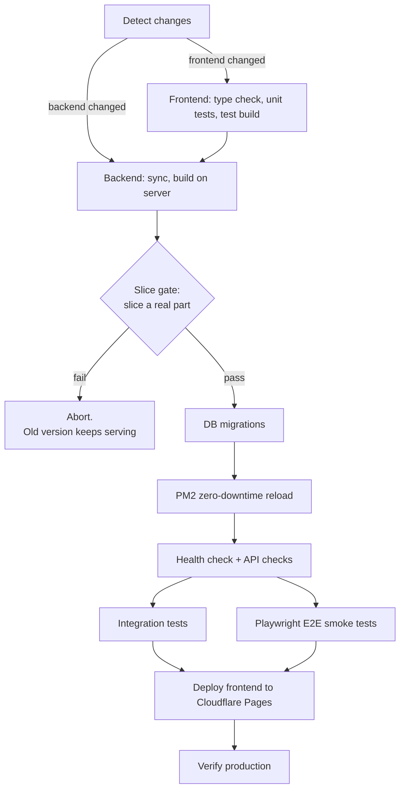

# Quot3D Delivery Pipeline

**How I ship a production SaaS several times a week, solo, without breaking it.**

[Quot3D](https://get-quot3d.com) is an automated quoting engine for 3D-printing businesses. A shop embeds it on their website; a customer uploads a model, and Quot3D slices it with the shop's own printer profiles and returns an accurate price in seconds. I built it, and I run it.

This repo is a case study of the CI/CD system behind it. The application code is private; the workflows in [`workflows/`](workflows/) are the real production pipelines, lightly sanitized (hostnames and private repo names replaced with GitHub `vars`, the generated `.env` trimmed).

| | |
|---|---|
| **Production deploys** | 200+ since December 2025 |
| **Successful runs** | 181 of the last 200 |
| **Median deploy, push to live** | ~4 minutes |
| **Commits** | 600+ |
| **Stack** | TypeScript / Node.js API (Prisma, PM2) on a Hetzner VPS, Postgres on Supabase, React SPA on Cloudflare Pages, plus a native C++ slicer built from OrcaSlicer's core library |

---

## Architecture



## The four pipelines

| Workflow | Trigger | What it does |
|---|---|---|
| [`ci-feature.yml`](workflows/ci-feature.yml) | Push to any feature branch | Type checks, backend unit tests against a real Postgres service container, frontend unit tests |
| [`ci-main.yml`](workflows/ci-main.yml) | Pull request to `main` | Everything above, plus an app-startup check, coverage upload and Playwright smoke and visual tests |
| [`deploy-production.yml`](workflows/deploy-production.yml) | Merge to `main` | Gated production deploy (below) |
| [`deploy-slicer.yml`](workflows/deploy-slicer.yml) | Manual | ~90-minute native build of the slicer from OrcaSlicer's core, cached, verified and deployed |

## Production deploy, stage by stage



## Design decisions (and the incidents behind them)

### 1. Only deploy what changed
The first job diffs the push (`before..after`) and sets `backend` / `frontend` outputs. A CSS fix doesn't restart the API; an API fix doesn't rebuild the SPA. A change to the workflows themselves runs everything. Manual `force_backend` / `force_frontend` inputs exist for when you need them.

### 2. One deploy at a time
Two PRs merged about 10 seconds apart once started two deploys into the same directory on the same server. Both ran `npm ci` into the same `node_modules`; the second failed with `ENOTEMPTY`, the build never ran, and the app was reloaded against a broken install, producing 502s in production.

The fix is one line of YAML, documented in place so nobody "optimizes" it away:

```yaml
concurrency:
  group: deploy-production
  cancel-in-progress: false   # cancelling mid-deploy leaves a half-updated server; queue instead
```

The server script also clears `node_modules` and retries `npm ci` once, so a single bad run doesn't need manual repair.

### 3. Fail closed
The remote deploy script originally ran straight through a failed `npm ci`. PM2 reported success, the workers crash-looped, and nginx served 502s. Now the script starts with `set -eo pipefail`, so any failed step stops the deploy *before* the reload and the previous version keeps serving. (`-u` is deliberately left off; the comment in the workflow explains why.)

### 4. Health checks lie, so prove the real thing works
`/health` only proves the slicer binary *starts*. Broken printer presets would deploy green and then fail every customer quote.

So before the new code takes any traffic, the pipeline runs a **slice gate**: it slices a real model through the exact code that's about to ship, for two fixture shops, using the real binary. It runs under `timeout` (kills the whole process group on a hang) and `nice` (so it can't starve the live workers), never touches the database, and if it fails the deploy stops before migrations and before the reload.

There is an emergency `skip_slice_gate` override for when the slicer itself is broken and an unrelated fix must ship. Using it posts a warning to the run summary naming who triggered it.

### 5. Migrations only after the gate
Database migrations run *after* the slice gate, so a refused deploy never leaves the schema ahead of the code. They use a direct connection rather than the connection pooler.

### 6. Zero-downtime reloads
The API runs as a 4-worker PM2 cluster. Deploys use `pm2 reload`, which rolls workers one at a time, so there's no restart gap.

### 7. Secrets stay out of the repo
The server's `.env` is generated from GitHub Secrets on every deploy and written with `chmod 600`. Production jobs run in a dedicated GitHub `environment`, so its secrets are scoped to deploys only.

### 8. A 90-minute native build, made routine
The slicer is a C++ binary built against OrcaSlicer's `libslic3r` with ~30 system libraries. Dependency builds take 20–30 minutes on their own, so they're cached and keyed on the exact OrcaSlicer commit; a `skip_cache` input forces a clean rebuild. The binary is smoke-tested (`--help`) in CI and again on the server before PM2 picks it up.

## Where AI fits

I build Quot3D with AI coding tools (Claude Code) every day. That's the reason this pipeline is as strict as it is: AI makes writing code fast, and the pipeline is what makes shipping it safe. Every change, whoever or whatever wrote it, goes through type checks, unit tests against real Postgres, end-to-end browser tests, and a real slice of a real part before a customer can see it.

## What I'd improve next

No pipeline is finished. The next changes I'd make:

- **Build once, ship an artifact.** The backend currently builds on the server. Building in CI and shipping a versioned artifact would make deploys faster and rollbacks a symlink switch.
- **Automated rollback.** Keep the previous release on disk and switch back automatically if post-deploy checks fail.
- **Pin the SSH host key** from a secret instead of `ssh-keyscan` at deploy time.
- **Run integration tests before the backend goes live**, not after.
- **Health checks through the public TLS endpoint** rather than the app port.
- **Add the slice gate to the slicer deploy too.** It currently swaps the binary in place after a `--help` check.

---

**Eric Blackwell**: DevOps & Release Engineer. Previously Build & Release at Amazon Devices and Egnyte.
[LinkedIn](https://www.linkedin.com/in/blackwelleric/) · [get-quot3d.com](https://get-quot3d.com)
